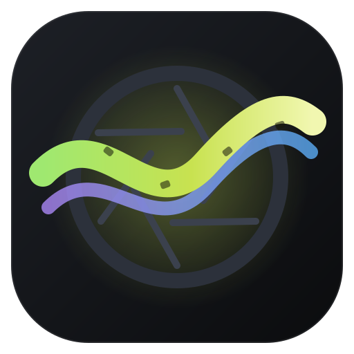

<p align="center">
  
</p>

<h1 align="center">镜流 · Frameflow Studio</h1>

<p align="center">从分镜到成片的 Windows 视频工作站</p>


## 工作台

| 模式 | 可以做什么 |
| --- | --- |
| **创作** | 写故事板、编排镜头、组织素材与旁白，快速搭出视频初稿。 |
| **精修** | 在多轨时间线上剪辑、调速、添加字幕和音乐，并预览成片。 |
| **拆片库** | 分析参考视频的镜头和节奏，把拆片结果留在项目里。 |

通过 FFmpeg 导出 MP4，也支持单独导出音频、外挂 SRT 字幕和素材署名。

## 本地运行

在 Windows 上安装 Node.js 22 或更新版本，然后在仓库目录运行以下命令。

```powershell
npm.cmd ci
npm.cmd run fetch:sample-media
npm.cmd run fetch:builtin-audio
npm.cmd run dev
```

启动后可以打开咖啡店示例工程，直接试用时间线和导出。两个素材脚本会准备示例视频和内置音频。开发模式使用 npm 安装的 FFmpeg，构建 Windows 安装包时会下载固定版本。

## 验证

```powershell
npm.cmd test
npm.cmd run build:renderer
node e2e/smoke.mjs
node e2e/full-flow.mjs
```

完整流程覆盖素材导入、多轨编辑、MP4 导出与 FFprobe 校验。有关数据存储和内置素材的说明见 [隐私说明](docs/PRIVACY.md)和[素材许可](docs/licenses/sample-media.md)。
