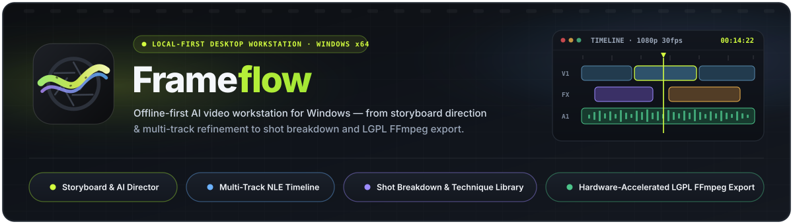
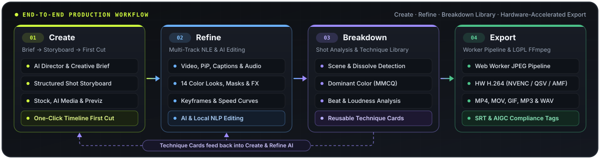

<div align="center">

<picture>
  <source media="(prefers-color-scheme: dark)" srcset="docs/images/hero-dark.svg" />
  <source media="(prefers-color-scheme: light)" srcset="docs/images/hero-light.svg" />
  
</picture>

<br />

<p>
  <a href="https://github.com/KennyMcSimpson/Frameflow/actions/workflows/ci.yml"></a>
  
  
  
  
  <a href="./LICENSE"></a>
</p>

<p>
  <strong>Local-first, AI-native desktop video workstation for Windows.</strong><br />
  Storyboarding · Multi-track nonlinear editing · Automated shot breakdown · Hardware-accelerated LGPL FFmpeg export — zero accounts, zero telemetry, and full offline editing.
</p>

<p>
  <strong>English</strong> · <a href="./README.zh-CN.md">简体中文</a> &nbsp;|&nbsp;
  <a href="#why-frameflow-instead-of-cloud-ai-editors-or-heavy-nles">Why Frameflow</a> ·
  <a href="#three-integrated-workspaces">Workspaces</a> ·
  <a href="#ai-video-generation--zero-key-stock-ecosystem">AI Ecosystem</a> ·
  <a href="#architecture--security">Architecture</a> ·
  <a href="#quick-start-windows">Quick Start</a> ·
  <a href="./CHANGELOG.md">Changelog</a>
</p>

</div>

<p align="center">
  
  <br />
  <sub><strong>Refine Workspace</strong> — bundled <em>"Morning Coffee"</em> sample project with media bin, unified Canvas2D preview, multi-track timeline, and real-time clip inspector.</sub>
</p>

---

## Why Frameflow Instead of Cloud AI Editors or Heavy NLEs?

| Dimension | Cloud AI Video Editors | Traditional Heavy NLEs | **Frameflow** |
| :--- | :--- | :--- | :--- |
| **Privacy & Ownership** | Footage and drafts live on vendor servers behind accounts and monthly credits. | Local files, but often bundled with cloud sign-ins, background updaters, or telemetry. | **100% local-first** — projects, media, caches, and logs stay on disk; zero accounts, zero telemetry, DPAPI-encrypted BYOK keys, and full offline editing & export. |
| **AI-to-Timeline Flow** | Quick prompt-to-clip generation, but limited multi-track control and opaque auto-edits. | Deep manual editing, while AI storyboarding, previz, and shot study remain external. | **End-to-end atomic pipeline** — brief → storyboard → previz / 8 AI video providers / zero-key stock → one-click rough cut → multi-track NLE with atomic undo/redo (`applyOps`). |
| **Preview-to-Export Fidelity** | Server-side re-renders frequently drift from web previews and cap output bitrates. | High fidelity at the cost of multi-GB installs and steep setup overhead. | **Single Canvas2D compositor** drives both live preview and exact-seek export through a Web Worker JPEG pipe into a **SHA-256-verified LGPL v3 FFmpeg** with GPU probing (`nvenc`/`qsv`/`amf`/`mf`) and CPU fallback. |
| **Shot Study & Security** | Closed cloud tools with no local shot-breakdown library or auditable boundaries. | Manual reference study; broad native plugin attack surface. | **Built-in Breakdown Library** (adaptive cut/dissolve detection, MMCQ palettes, 70 offline Technique Cards) inside a **hardened Electron 45 sandbox** (strict CSP, async DNS SSRF guards, 5 Electron Fuses). |

---

## Three Integrated Workspaces

<p align="center">
  <picture>
    <source media="(prefers-color-scheme: dark)" srcset="docs/images/workflow-dark.svg" />
    <source media="(prefers-color-scheme: light)" srcset="docs/images/workflow-light.svg" />
    
  </picture>
</p>

| Workspace | What You Can Do |
| :--- | :--- |
| **Create (`创作`)** | Chat with the AI Director (or offline template director) to craft a structured Creative Brief and shot-by-shot Storyboard. Populate each shot with zero-key stock footage, AI images, AI video clips, or watermarked Canvas2D Previz — then assemble a multi-track timeline in one click. |
| **Refine (`精修`)** | Edit across a magnetic main video track, up to 4 PiP/image/sticker overlay tracks, multi-row text & caption tracks, and multi-clip audio with waveforms & beat markers. Apply 14 color looks, 10 camera motions, 16 transitions, 8 effects, masks, keyframes, speed curves, and range-focused AI or local natural-language edits. |
| **Breakdown Library (`拆片库`)** | Deconstruct local videos or downloaded reference clips into shots via single-pass adaptive scene/dissolve detection, MMCQ dominant color palettes, motion/loudness/beat curves, and optional AI vision annotations. Save findings as reusable **Technique Cards** (70 built-in offline cards included) and apply them straight to timeline clips. |

---

## AI, Video Generation & Zero-Key Stock Ecosystem

Frameflow separates provider configuration from core editing so you can combine local tools, free open-license archives, and your own API keys — or stay completely offline.

| Capability | Supported Providers & Engines | Notes |
| :--- | :--- | :--- |
| **Director, Script & Editing AI** | OpenAI-compatible Chat API, opt-in local Codex CLI, Offline Local Director & Chinese NLP | Strict JSON Schema output with whole-project memory; automatic offline rule fallback |
| **AI Image Generation** | Volcengine Ark (Seedream), OpenAI-compatible Image API | Falls back to watermarked Canvas2D Previz when unconfigured |
| **AI Video Generation** | Seedance (Ark), Runway Gen-4, Luma Ray 2, Kling, MiniMax Hailuo, Google Veo, OpenAI Sora 2, Fal.ai | Includes built-in local `mock` demo provider & per-provider concurrency limiting |
| **Speech-to-Captions (ASR)** | On-demand local `whisper.cpp` (ggml models) or OpenAI Whisper API | Local mode keeps all audio on-device after one-time model download; exports `.srt` |
| **Zero-Key & Opt-In Stock** | Wikimedia Commons, Openverse, Internet Archive, NASA (zero API key); opt-in Pexels, Pixabay & consent-gated `yt-dlp` | Ships Mixkit *"Morning Coffee"* sample footage and 23 CC0 music/SFX tracks (FreePD + synthesized) |
| **Export & Delivery** | Bundled SHA-256-verified LGPL v3 FFmpeg/FFprobe (`MP4`, `MOV`, `GIF`, `MP3`, `WAV`, `SRT`) | Web Worker JPEG pipe, GPU probing with CPU fallback, BT.601→BT.709 color tagging, credits & GB 45438-2025 AIGC metadata |

---

## Architecture & Security

<p align="center">
  <picture>
    <source media="(prefers-color-scheme: dark)" srcset="docs/images/architecture-dark.svg" />
    <source media="(prefers-color-scheme: light)" srcset="docs/images/architecture-light.svg" />
    
  </picture>
</p>

- **Pure, Testable Engine (`src/engine/`)** — Zero DOM or Electron dependencies; timeline layout, atomic editing ops (`applyOps`), color matching, pacing, speed curves, and local NLP run directly under `node --test`. Project saves use temp-file + `fsync` + atomic rename with `.prev.json` recovery.
- **Single Compositor for Preview & Export (`src/render/`, `src/export/`)** — One Canvas2D renderer powers live playback and exact-seek export, offloading JPEG compression to an inline Web Worker (`jpegEncoder.worker.js`) feeding FFmpeg `image2pipe` under bounded 32-frame backpressure.
- **Hardened Electron 45 Sandbox & CSP (`electron/main.cjs`, `src/index.html`)** — `contextIsolation: true`, `sandbox: true` (`app.enableSandbox()`), main-frame IPC origin checks (`isTrustedSender`), and strict production CSP (`connect-src 'self' ffmedia:` blocks direct renderer XHR/fetch/WebSocket calls to external APIs, while `img-src` and `media-src` permit `https:` for stock thumbnails and previews).
- **Local Path & Outbound Network Guards (`electron/ipc/system.cjs`, `electron/lib/urlSafety.cjs`)** — `ffmedia://` streams only allowlisted media/project paths (`403` otherwise); `shell:openPath` enforces an 18-extension `ALLOWED_OPEN_EXT` allowlist with fail-closed `realpath`, UNC rejection, and trailing dot/space checks; async DNS SSRF protection blocks loopback, private, link-local, CGNAT, and mapped IPv6 targets across AI, video generation, stock, ASR, and `yt-dlp` requests while `isTrustedHostForBase` prevents credential leakage.
- **Encrypted Secrets & 5 Electron Fuses** — API keys are encrypted at rest with Windows DPAPI via Electron `safeStorage` (`secrets.json`), never returned in plaintext over IPC, and scrubbed from logs via `log.redact()`. Packaged binaries enforce and audit all 5 Electron Fuses (`RunAsNode`, `NodeOptions`, `NodeCliInspect`, `EmbeddedAsarIntegrityValidation`, `OnlyLoadAppFromAsar`).
- **Deep Dive** — Read [docs/ARCHITECTURE.md](docs/ARCHITECTURE.md) for subsystem details and IPC protocols, [docs/PRIVACY.en.md](docs/PRIVACY.en.md) ([中文版](docs/PRIVACY.md)) for data and network disclosure, and [SECURITY.md](SECURITY.md) for vulnerability reporting.

---

## Quick Start (Windows)

> **Language Note:** The in-app desktop UI is currently in Simplified Chinese (`zh-CN`). Developer documentation, architecture guides, and community files are maintained in English (with a companion [简体中文 README](./README.zh-CN.md)).

**Prerequisites:** Windows 10/11 (x64) and [Node.js 22+](https://nodejs.org/).

```powershell
git clone https://github.com/KennyMcSimpson/Frameflow.git
cd Frameflow
npm ci

# Optional: populate the "Morning Coffee" sample clips and built-in CC0 audio library
npm run fetch:sample-media
npm run fetch:builtin-audio

# Launch Vite dev server + Electron app
npm run dev
```

In development mode, Frameflow resolves FFmpeg from `vendor/ffmpeg/bin` (if `npm run fetch:ffmpeg` was run) or falls back to npm-installed `ffmpeg-static` / `ffprobe-static`. Production builds strictly bundle the SHA-256-verified LGPL v3 shared FFmpeg binaries and exclude static GPL packages.

---

## Testing & Packaging

```powershell
# Unit & module tests (56 suites: 694 passing offline tests + 1 opt-in gated live network test)
npm test

# Production renderer bundle (Vite -> dist-renderer/)
npm run build:renderer

# Playwright + Electron E2E smoke test
npm run e2e

# Full E2E pipeline (import -> multi-track edit -> MP4 export -> FFprobe verify)
npm run e2e:full

# Build Windows NSIS installer & portable binary (LGPL FFmpeg fetch, licenses, fuse & ASAR audits)
npm run dist
npm run dist:portable
```

Packaging automatically runs `scripts/after-pack.cjs` and `scripts/check-artifacts.mjs` to verify all 5 Electron Fuses, LGPL v3 FFmpeg compliance, license bundles, absence of sourcemaps or GPL static binaries in `app.asar`, and bundle size budgets.

---

## Project Structure

```text
Frameflow/
├── electron/
│   ├── main.cjs                # Hardened Electron main process, ffmedia://, crash recovery
│   ├── preload.cjs             # Sandboxed contextBridge exposing window.ff
│   ├── ipc/                    # 9 domain IPC handlers (store, media, export, ai, videogen, asr, analysis, web, system)
│   └── lib/                    # FFmpeg/encoder probing, shotdetect workers, urlSafety SSRF guard, safeStorage, videogen adapters
├── src/
│   ├── engine/                 # Pure JS editing engine (model, timeline, ops, history, keyframes, localnlp, 70 techniques)
│   ├── render/                 # Canvas2D compositor, 14 looks, transitions, motion, text, previz, mediaPool
│   ├── ai/                     # Strict JSON schemas, director/editor/analyze prompts, offline localDirector
│   ├── export/                 # Export driver, Web Worker JPEG encoder, audioPlan, presets, AIGC metadata
│   ├── ui/                     # React 19 UI (Create, Refine, Library modes, dialogs, Zustand store)
│   └── styles/                 # Obsidian dark-studio design tokens and stylesheets
├── scripts/                    # Dev launcher, LGPL FFmpeg fetcher, sample media/audio fetchers, license & artifact audits
├── tests/                      # 56 Node unit/integration test suites (*.test.mjs)
├── e2e/                        # Playwright Electron smoke, full-flow, packaged & render harnesses
├── build/                      # App icons, MIT installer license, privacy notice, generated THIRD_PARTY_LICENSES.txt
└── docs/                       # Architecture, privacy (EN/ZH), light/dark SVG diagrams, and sample media licenses
```

---

## License & Third-Party Notices

- **Source Code:** Licensed under the [MIT License](LICENSE).
- **Bundled FFmpeg:** Distributed unmodified as a dynamically linked **LGPL v3** build (`resources/ffmpeg/`), replaceable by users under LGPL terms; pinned source and license details are documented in [build/THIRD_PARTY_LICENSES.txt](build/THIRD_PARTY_LICENSES.txt).
- **Sample Media & Built-In Audio:** Mixkit Free License sample clips ([docs/licenses/sample-media.md](docs/licenses/sample-media.md)) and 23 CC0 1.0 FreePD music / synthesized SFX tracks.
- **Policies & Community:** [Privacy Notice (English)](docs/PRIVACY.en.md) · [隐私说明 (中文)](docs/PRIVACY.md) · [Security Policy](SECURITY.md) · [Contributing Guide](CONTRIBUTING.md) · [Changelog](CHANGELOG.md)
