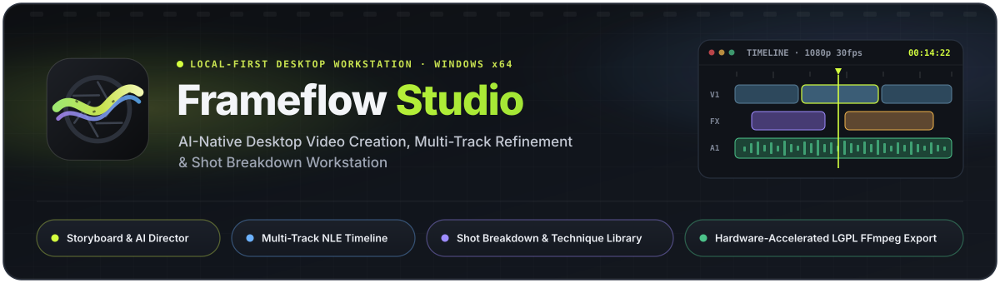
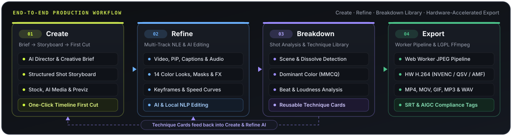
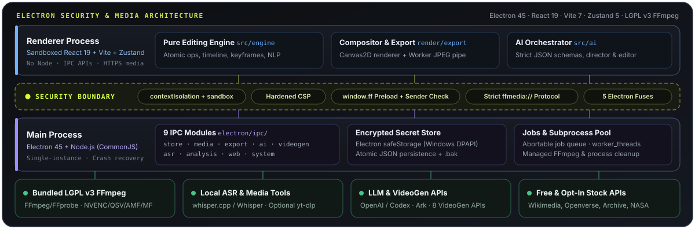

<p align="center">
  
</p>

<p align="center">
  <a href="https://github.com/KennyMcSimpson/frameflow-studio/actions/workflows/ci.yml"></a>
  <a href="LICENSE"></a>
  
  
  =22" />
  
</p>

**Frameflow Studio** (镜流) is a local-first, AI-native desktop video workstation for Windows that brings storyboarding, multi-track nonlinear editing, automated shot breakdown, and hardware-accelerated FFmpeg export into one cohesive studio. Projects, assets, and exports stay on your machine—with zero accounts, zero telemetry, and full offline editing capability.

<p align="center">
  
  <br />
  <em>Frameflow Studio Refine workspace displaying the bundled "Morning Coffee" sample project, multi-track timeline, and real-time clip inspector.</em>
</p>

---

## Why Frameflow Studio?

- **Local-First Privacy, Zero Cloud Lock-In** — Projects, footage, caches, and logs remain strictly on your disk. API keys are encrypted via Electron `safeStorage` (Windows DPAPI), and offline editing + export work without configuring any API key.
- **Complete End-to-End Pipeline** — Go from a plain-language brief and storyboard to a multi-track rough cut, refined color/motion/caption edit, shot breakdown study, and delivery-ready export without switching apps.
- **Hardened Electron Security** — Sandboxed renderer (`contextIsolation: true`, `sandbox: true`), strict production CSP, IPC sender verification, allowlisted `ffmedia://` streaming, and 5 verified Electron Fuses.
- **LGPL-Clean Hardware Export** — Packaged builds ship a pinned, SHA-256-verified LGPL v3 shared FFmpeg build (`resources/ffmpeg/`) with automatic GPU probing (`h264_nvenc`, `h264_qsv`, `h264_amf`, `h264_mf`) and CPU fallback.
- **Atomic & Honest Engineering** — Multi-op edits apply atomically with full undo/redo; AI Previz clips are explicitly watermarked as previz; project saves use temp-file + `fsync` + atomic rename with `.prev.json` recovery.

---

## Three Integrated Workspaces

<p align="center">
  
</p>

| Workspace | What You Can Do |
| --- | --- |
| **Create (`创作`)** | Chat with the AI Director (or offline template director) to craft a structured Creative Brief and shot-by-shot Storyboard. Populate each shot with zero-key stock footage, AI images, AI video clips, or animated Canvas2D Previz—then assemble a multi-track timeline in one click. |
| **Refine (`精修`)** | Edit across a magnetic main video track, up to 4 PiP/image/sticker overlay tracks, multi-row text & caption tracks, and multi-clip audio with waveforms & beat markers. Apply 14 color looks, 10 camera motions, 16 transitions, 8 effects, masks, keyframes, speed curves, and range-focused AI or local natural-language edits. |
| **Breakdown Library (`拆片库`)** | Deconstruct local videos or downloaded reference clips into shots using single-pass adaptive scene/dissolve detection, MMCQ dominant color palettes, motion/loudness/beat curves, and optional AI vision annotations. Save findings as reusable **Technique Cards** (70 built-in offline cards included) and apply them straight to timeline clips. |

---

## AI, Video Generation & Stock Ecosystem

Frameflow Studio separates provider configuration from core editing so you can mix local tools, free open-license archives, and your own API keys—or stay completely offline.

| Capability | Supported Providers & Engines | Notes |
| --- | --- | --- |
| **Director, Script & Editing AI** | OpenAI-compatible Chat API, Local Codex CLI (opt-in), Offline Local Director & NLP | Strict JSON Schema output with whole-project memory; automatic offline rule fallback |
| **AI Image Generation** | Volcengine Ark (Seedream), OpenAI-compatible Image API | Falls back to Canvas2D Previz when unconfigured |
| **AI Video Generation** | Seedance (Ark), Runway Gen-4, Luma Ray 2, Kling, MiniMax Hailuo, Google Veo, OpenAI Sora 2, Fal.ai | Includes built-in local `mock` demo provider & per-provider concurrency limiting |
| **Speech-to-Captions (ASR)** | Local `whisper.cpp` (on-demand ggml models) or OpenAI Whisper API | Local mode keeps all audio on-device after one-time model download |
| **Built-In & Free Stock Media** | Wikimedia Commons, Openverse, Internet Archive, NASA (zero API key); optional Pexels & Pixabay | Ships Mixkit sample footage and 23 CC0 music/SFX tracks (FreePD + synthesized) |
| **Export & Delivery** | Bundled LGPL v3 FFmpeg/FFprobe (`MP4`, `MOV`, `GIF`, `MP3`, `WAV`, `SRT`) | Web Worker JPEG pipe, BT.601→BT.709 color tagging, credits & GB 45438-2025 AIGC metadata |

---

## Architecture & Security

<p align="center">
  
</p>

- **Pure, Testable Core (`src/engine/`)** — Zero DOM or Electron dependencies; timeline layout, atomic editing ops, color matching, pacing, speed curves, and local NLP run directly under `node --test`.
- **Single Compositor for Preview & Export (`src/render/`, `src/export/`)** — One Canvas2D renderer powers live playback and exact-seek export, offloading JPEG compression to an inline Web Worker (`jpegEncoder.worker.js`) feeding FFmpeg with bounded backpressure.
- **Zero-Trust IPC & Media Boundary (`electron/main.cjs`, `electron/preload.cjs`)** — Every `ipcMain.handle` verifies main-frame app origin; `ffmedia://` serves only allowlisted project/media paths; `shell:openPath` enforces an 18-extension allowlist with fail-closed `realpath`, UNC, and trailing dot/space checks; secrets never cross back to the renderer in plaintext.
- **Deep Dive**: Read [docs/ARCHITECTURE.md](docs/ARCHITECTURE.md) for module boundaries, IPC protocols, and packaging verification, and [docs/PRIVACY.en.md](docs/PRIVACY.en.md) ([中文版](docs/PRIVACY.md)) for data storage and network disclosure.

---

## Quick Start (Windows)

> **Language Note:** The in-app desktop UI is currently in Simplified Chinese (`zh-CN`). Developer documentation, architecture guides, and community files are maintained in English.

**Prerequisites:** Windows 10/11 (x64) and [Node.js 22+](https://nodejs.org/).

```powershell
git clone https://github.com/KennyMcSimpson/frameflow-studio.git
cd frameflow-studio
npm ci

# Optional: populate the "Morning Coffee" sample clips and built-in CC0 audio library
npm run fetch:sample-media
npm run fetch:builtin-audio

# Launch Vite dev server + Electron app
npm run dev
```

In development mode, Frameflow Studio resolves FFmpeg from `vendor/ffmpeg/bin` (if `npm run fetch:ffmpeg` was run) or falls back to npm-installed `ffmpeg-static` / `ffprobe-static`. Production builds strictly bundle the SHA-256-verified LGPL v3 shared FFmpeg binaries and exclude static GPL packages.

---

## Testing & Packaging

```powershell
# Unit & module tests (pure Node test runner, 56 test suites)
npm test

# Production renderer bundle (Vite -> dist-renderer/)
npm run build:renderer

# Playwright + Electron E2E smoke test
npm run e2e

# Full E2E pipeline (import -> multi-track edit -> MP4 export -> FFprobe verify)
npm run e2e:full

# Build Windows NSIS installer & portable binary (fetches LGPL FFmpeg, generates licenses, audits fuses & ASAR)
npm run dist
npm run dist:portable
```

Packaging automatically runs `scripts/after-pack.cjs` and `scripts/check-artifacts.mjs` to verify all 5 Electron Fuses, LGPL v3 FFmpeg compliance, license bundles, absence of sourcemaps or GPL static binaries in `app.asar`, and bundle size budgets.

---

## Project Structure

```text
frameflow-studio/
├── electron/
│   ├── main.cjs                # Hardened Electron main process, ffmedia://, crash recovery
│   ├── preload.cjs             # Sandboxed contextBridge exposing window.ff
│   ├── ipc/                    # 9 domain IPC handlers (store, media, export, ai, videogen, asr, analysis, web, system)
│   └── lib/                    # FFmpeg/encoder probing, shotdetect workers, safeStorage settings, videogen adapters
├── src/
│   ├── engine/                 # Pure JS editing engine (model, timeline, ops, history, keyframes, localnlp, 70 techniques)
│   ├── render/                 # Canvas2D compositor, 14 looks, transitions, motion, text, previz, mediaPool
│   ├── ai/                     # Strict JSON schemas, director/editor/analyze prompts, offline localDirector
│   ├── export/                 # Export driver, Web Worker JPEG encoder, audioPlan, presets, AIGC metadata
│   ├── ui/                     # React 19 UI (Create, Refine, Library modes, dialogs, Zustand store)
│   └── styles/                 # Obsidian dark-studio design tokens and stylesheets
├── scripts/                    # Dev launcher, LGPL FFmpeg fetcher, sample media/audio fetchers, license & artifact audits
├── tests/                      # 56 Node unit/integration test suites (*.test.mjs)
├── e2e/                        # Playwright Electron smoke, full-flow, packaged & render harnesses
├── build/                      # App icons, MIT installer license, privacy notice, generated THIRD_PARTY_LICENSES.txt
└── docs/                       # Architecture, privacy (EN/ZH), visual diagrams, and sample media licenses
```

---

## License & Third-Party Notices

- **Source Code:** Licensed under the [MIT License](LICENSE).
- **Bundled FFmpeg:** Distributed unmodified as a dynamically linked **LGPL v3** build (`resources/ffmpeg/`), replaceable by users under LGPL terms; pinned source and license details are documented in [build/THIRD_PARTY_LICENSES.txt](build/THIRD_PARTY_LICENSES.txt).
- **Sample Media & Built-In Audio:** Mixkit Free License sample clips ([docs/licenses/sample-media.md](docs/licenses/sample-media.md)) and CC0 1.0 FreePD music / synthesized SFX.
- **Policies & Community:** [Privacy Notice (English)](docs/PRIVACY.en.md) · [隐私说明 (中文)](docs/PRIVACY.md) · [Security Policy](SECURITY.md) · [Contributing Guide](CONTRIBUTING.md) · [Changelog](CHANGELOG.md)
