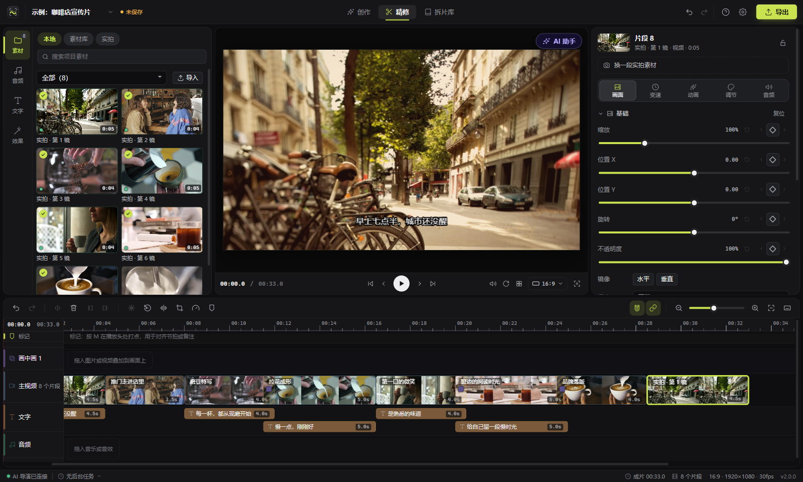

<div align="center">

<picture>
  <source media="(prefers-color-scheme: dark)" srcset="docs/images/hero-dark.svg" />
  <source media="(prefers-color-scheme: light)" srcset="docs/images/hero-light.svg" />
  
</picture>

<br />

<p>
  <a href="https://github.com/KennyMcSimpson/Frameflow/actions/workflows/ci.yml"></a>
  <a href="./.github/workflows/windows-release.yml"></a>
  <a href="./docs/AGENT-INTEGRATION.md"></a>
  
  
  <a href="#testing--packaging"></a>
  <a href="./LICENSE"></a>
</p>

<p>
  <strong>Frameflow v2.1.0 — The Agent-Embeddable Desktop Video Workstation for Windows.</strong><br />
  Storyboarding · Multi-track NLE · Shot breakdown · Headless Agent CLI &amp; Live Watch · Hardware-accelerated LGPL FFmpeg — bilingual EN/ZH UI, zero accounts, zero telemetry, and full offline editing.
</p>

<p>
  <strong>English</strong> · <a href="./README.zh-CN.md">简体中文</a> &nbsp;|&nbsp;
  <a href="#why-frameflow-instead-of-cloud-ai-editors-or-heavy-nles">Why Frameflow</a> ·
  <a href="#three-integrated-workspaces">Workspaces</a> ·
  <a href="#embed-frameflow-in-any-coding-agent">Agent Integration</a> ·
  <a href="#ai-video-generation--zero-key-stock-ecosystem">AI Ecosystem</a> ·
  <a href="#architecture--security">Architecture</a> ·
  <a href="#quick-start-windows">Quick Start</a> ·
  <a href="./CHANGELOG.md">Changelog</a>
</p>

</div>

<p align="center">
  
  <br />
  <sub><strong>Refine Workspace</strong> — bundled <em>"Morning Coffee"</em> sample project with media bin, unified Canvas2D preview, multi-track timeline, real-time clip inspector, and one-click English / 简体中文 UI switching.</sub>
</p>

---

## Why Frameflow Instead of Cloud AI Editors or Heavy NLEs?

| Dimension | Cloud AI Video Editors | Traditional Heavy NLEs | **Frameflow v2.1** |
| :--- | :--- | :--- | :--- |
| **Privacy & Ownership** | Footage and drafts live on vendor servers behind accounts and monthly credits. | Local files, but often bundled with cloud sign-ins, background updaters, or telemetry. | **100% local-first** — projects, media, caches, and logs stay on disk; zero accounts, zero telemetry, DPAPI-encrypted BYOK keys, and full offline editing & export. |
| **Agent-Native Editing** | Closed browser canvases with no scriptable project model or external coding-agent integration. | Fragile proprietary project binaries and plugin SDKs ill-suited for LLM agent workflows. | **Outside-In Agent Workstation** — headless `frameflow` CLI + cross-host `SKILL.md` + opt-in Thin MCP (`--readonly` supported) drive atomic `.ffproj` edits while **Desktop Live Watch** hot-reloads the GUI in **`<100ms`** with full **`Ctrl+Z` undo**. |
| **AI-to-Timeline Flow** | Quick prompt-to-clip generation, locked to one vendor's model stack. | Deep manual editing, while AI storyboarding, previz, and shot study remain external. | **Neutral multi-provider pipeline** — 8 neutral API presets + 3 equal-footing opt-in Agent CLIs + 8 AI video providers + zero-key stock → one-click rough cut → multi-track NLE with atomic `applyOps`. |
| **Preview-to-Export Fidelity** | Server-side re-renders frequently drift from web previews and cap output bitrates. | High fidelity at the cost of multi-GB installs and steep setup overhead. | **Single Canvas2D compositor** drives both live preview and exact-seek export through a Web Worker JPEG pipe into a **SHA-256-verified LGPL v3 FFmpeg** with GPU probing (`nvenc`/`qsv`/`amf`/`mf`) and CPU fallback. |
| **Shot Study & Security** | Closed cloud tools with no local shot-breakdown library or auditable boundaries. | Manual reference study; broad native plugin attack surface. | **Built-in Breakdown Library** (adaptive cut/dissolve detection, MMCQ palettes, 70 offline Technique Cards) inside a **hardened Electron 45 sandbox** (strict CSP, async DNS SSRF guards, 5 Electron Fuses). |

---

## Three Integrated Workspaces

<p align="center">
  <picture>
    <source media="(prefers-color-scheme: dark)" srcset="docs/images/workflow-dark.svg" />
    <source media="(prefers-color-scheme: light)" srcset="docs/images/workflow-light.svg" />
    
  </picture>
</p>

| Workspace | What You Can Do |
| :--- | :--- |
| **Create (`创作`)** | Chat with the AI Director (or offline template director) to craft a structured Creative Brief and shot-by-shot Storyboard. Populate each shot with zero-key stock footage, AI images, AI video clips, or watermarked Canvas2D Previz — then assemble a multi-track timeline in one click. |
| **Refine (`精修`)** | Edit across a magnetic main video track, up to 4 PiP/image/sticker overlay tracks, multi-row text & caption tracks, and multi-clip audio with waveforms & beat markers. Apply 14 color looks, 10 camera motions, 16 transitions, 8 effects, masks, keyframes, speed curves, and range-focused AI or local natural-language edits. |
| **Breakdown Library (`拆片库`)** | Deconstruct local videos or downloaded reference clips into shots via single-pass adaptive scene/dissolve detection, MMCQ dominant color palettes, motion/loudness/beat curves, and optional AI vision annotations. Save findings as reusable **Technique Cards** (70 built-in offline cards included) and apply them straight to timeline clips. |

---

## Embed Frameflow in Any Coding Agent

Frameflow v2.1 is built **Outside-In** so coding agents (Claude Code, Codex CLI, Gemini CLI, Cursor, Antigravity, OpenCode, PI, or Claude Desktop) can co-edit real multi-track `.ffproj` timelines alongside the desktop workstation — **with zero background daemons and zero standing MCP token tax by default**.

```text
  Coding Agent (Antigravity / Claude Code / Codex / Gemini / OpenCode / PI / Cursor / Claude Desktop)
        │
        ├─▶ Default (0 daemon, 0 token tax): skills/frameflow/SKILL.md + bin/frameflow.mjs
        └─▶ Opt-In (MCP-only hosts):         bin/frameflow-mcp.mjs [--readonly] (6 typed stdio tools)
        │
        ▼  lintOps → applyOps → diffProject → needsConfirm → atomic write + .bak.ffproj + meta.lastAgentEdit
  Desktop Live Watch (electron/lib/projectWatch.cjs — SHA-256 echo-free watcher)
        │
        └─▶ <100ms hot-reload in Refine/Create GUI + pushed to Undo stack (Ctrl+Z reverts any agent edit)
```

| Integration Layer | Entry Point | What It Enables |
| :--- | :--- | :--- |
| **Headless Agent CLI** | `bin/frameflow.mjs` | Zero-dependency Node CLI running the exact same pure `src/engine/` modules with `--json` output: `init`, `inspect` (`--focus <start>..<end>`), `ops-schema`, `storyboard` (auto-creates `.ffproj` if absent; backs up to `.bak.ffproj` before overwriting an existing file), `apply` (`--ops <ops.json> \| --ops-json '<json>' \| --stdin`, `--ops -` stdin alias, `--dry-run` / `--allow-destructive`), `breakdown`, `stock search`, `export-srt`, `export-plan`, and `doctor`. |
| **Desktop Live Watch** | `electron/lib/projectWatch.cjs` | Watches the active project file's parent directory by exact filename, filters self-writes via SHA-256 digests, reloads external agent edits in **`<100ms`**, and pushes a native history snapshot so **`Ctrl+Z`** cleanly reverts the entire agent batch. |
| **Cross-Host Agent Skill** | `skills/frameflow/SKILL.md` | Zero-hardcoded-path skill contract for **Antigravity, Claude Code, Codex CLI, Gemini CLI, OpenCode, and PI** — enforces inspect → `ops-schema` → `--dry-run` → atomic `apply` with deterministic destructive-edit confirmation gates. |
| **Opt-In Thin MCP** | `bin/frameflow-mcp.mjs` | Zero-dependency stdio MCP server exposing **6 minimal typed tools** (`frameflow_inspect`, `frameflow_ops_schema`, `frameflow_apply_ops`, `frameflow_storyboard`, `frameflow_stock_search`, `frameflow_export_srt`) with both `Content-Length` and `ndjson` framing plus `--readonly` mode. |

```powershell
# 1. Create a vertical short-form project with storyboard + previz first cut
#    (auto-creates demo.ffproj if absent; writes demo.bak.ffproj before overwriting an existing file)
node bin/frameflow.mjs storyboard demo.ffproj --brief "25s warm specialty coffee promo" --duration 25 --aspect 9:16 --first-cut --agent "claude-code" --json

# 2. Inspect generated clips/tracks (--focus 0..15; 0:15 also accepted), search stock, or break down a video
node bin/frameflow.mjs inspect demo.ffproj --focus 0..15 --json
node bin/frameflow.mjs stock search "coffee pour slow motion" --kind video --limit 8 --json
node bin/frameflow.mjs breakdown sample.mp4 --json

# 3. Validate Ops (--ops <ops.json> | --ops-json '<json>' | --stdin; --ops - alias), then commit atomically (<100ms Live Watch + Ctrl+Z undo)
node bin/frameflow.mjs apply demo.ffproj --ops edits.json --dry-run --json
node bin/frameflow.mjs apply demo.ffproj --ops edits.json --agent "claude-code" --label "Warm grade + crossfade" --json

# 4. Export subtitles directly to .srt
node bin/frameflow.mjs export-srt demo.ffproj --out demo.srt --json
```

> **Full Guide:** Read **[docs/AGENT-INTEGRATION.md](docs/AGENT-INTEGRATION.md)** for complete CLI flags, `ops-schema` payloads, safety-gate rules (`needsConfirm`), cross-host `SKILL.md` installation, and Claude Desktop / Cursor / Windsurf MCP configs.

---

## AI, Video Generation & Zero-Key Stock Ecosystem

Frameflow separates provider configuration from core editing so you can combine local models, free open-license archives, neutral BYOK APIs, and equal-footing local agent CLIs — or stay completely offline.

| Capability | Supported Providers & Engines | Notes |
| :--- | :--- | :--- |
| **Neutral Multi-API Presets (Default)** | **OpenAI**, **DeepSeek**, **Anthropic Claude** (native Messages API), **Google Gemini**, **OpenRouter**, **Volcengine Ark**, plus keyless local **Ollama** & **LM Studio** (`electron/lib/aiPresets.cjs`) | First-class neutral presets with strict JSON Schema output, whole-project memory, and automatic offline Local Director / rule-based NLP fallback |
| **Opt-In Local Agent CLIs (Equal-Footing)** | **Claude Code (`claude`)**, **Codex CLI (`codex`)**, **Gemini CLI (`gemini`)** (`electron/lib/agentCli.cjs`) | Treated on equal footing and strictly **opt-in** — never silently hijacking your configured API keys or neutral provider presets |
| **AI Image Generation** | Volcengine Ark (Seedream), OpenAI-compatible Image API | Falls back to watermarked Canvas2D Previz when unconfigured |
| **AI Video Generation** | Seedance (Ark), Runway Gen-4, Luma Ray 2, Kling, MiniMax Hailuo, Google Veo, OpenAI Sora 2, Fal.ai | Includes built-in local `mock` demo provider & per-provider concurrency limiting |
| **Speech-to-Captions (ASR)** | On-demand local `whisper.cpp` (ggml models) or OpenAI Whisper API | Local mode keeps all audio on-device after one-time model download; exports `.srt` |
| **Zero-Key & Opt-In Stock** | Wikimedia Commons, Openverse, Internet Archive, NASA (zero API key); opt-in Pexels, Pixabay & consent-gated `yt-dlp` | Ships Mixkit *"Morning Coffee"* sample footage and 23 CC0 music/SFX tracks (FreePD + synthesized) |
| **Export & Delivery** | Bundled SHA-256-verified LGPL v3 FFmpeg/FFprobe (`MP4`, `MOV`, `GIF`, `MP3`, `WAV`, `SRT`) | Web Worker JPEG pipe, GPU probing with CPU fallback, BT.601→BT.709 color tagging, credits & GB 45438-2025 AIGC metadata |
| **Bilingual Desktop UI** | Live **`English` (`en-US`)** ↔ **`简体中文` (`zh-CN`)** switching (`src/ui/i18n.js`) | Switch seamlessly at any time from the **TopBar** or **Settings** dialog — persisted automatically with zero restart required |

---

## Architecture & Security

<p align="center">
  <picture>
    <source media="(prefers-color-scheme: dark)" srcset="docs/images/architecture-dark.svg" />
    <source media="(prefers-color-scheme: light)" srcset="docs/images/architecture-light.svg" />
    
  </picture>
</p>

- **Pure, Testable Engine (`src/engine/`)** — Zero DOM or Electron dependencies; timeline layout, atomic editing ops (`applyOps`), color matching, pacing, speed curves, and local NLP run identically inside the desktop app, `bin/frameflow.mjs`, and `node --test`. Project saves use temp-file + `fsync` + atomic rename with `.prev.json` recovery.
- **Agent CLI, Live Watch & Opt-In MCP (`bin/`, `electron/lib/projectWatch.cjs`)** — `bin/frameflow.mjs` and `bin/frameflow-mcp.mjs` share the exact `lintOps` → `applyOps` → `diffProject` → `needsConfirm` pipeline with atomic `.bak.ffproj` backups; `projectWatch.cjs` detects external atomic writes via parent-directory watching and SHA-256 self-write filtering in `<100ms`, recording undoable GUI snapshots.
- **Single Compositor for Preview & Export (`src/render/`, `src/export/`)** — One Canvas2D renderer powers live playback and exact-seek export, offloading JPEG compression to an inline Web Worker (`jpegEncoder.worker.js`) feeding FFmpeg `image2pipe` under bounded 32-frame backpressure.
- **Hardened Electron 45 Sandbox & CSP (`electron/main.cjs`, `src/index.html`)** — `contextIsolation: true`, `sandbox: true` (`app.enableSandbox()`), main-frame IPC origin checks (`isTrustedSender`), and strict production CSP (`connect-src 'self' ffmedia:` blocks direct renderer XHR/fetch/WebSocket calls to external APIs, while `img-src` and `media-src` permit `https:` for stock thumbnails and previews).
- **Local Path & Outbound Network Guards (`electron/ipc/system.cjs`, `electron/lib/urlSafety.cjs`)** — `ffmedia://` streams only allowlisted media/project paths (`403` otherwise); `shell:openPath` enforces an 18-extension `ALLOWED_OPEN_EXT` allowlist with fail-closed `realpath`, UNC rejection, and trailing dot/space checks; async DNS SSRF protection blocks loopback, private, link-local, CGNAT, and mapped IPv6 targets across cloud APIs, video generation, stock, ASR, and `yt-dlp` requests while `isTrustedHostForBase` prevents credential leakage.
- **Encrypted Secrets & 5 Electron Fuses** — API keys are encrypted at rest with Windows DPAPI via Electron `safeStorage` (`secrets.json`), never returned in plaintext over IPC, and scrubbed from logs via `log.redact()`. Local Agent CLI adapters validate binary paths (UNC/realpath guards) and model identifiers against flag injection, with bounded stdout/stderr caps and process-tree termination on cancel. Packaged binaries enforce and audit all 5 Electron Fuses (`RunAsNode`, `NodeOptions`, `NodeCliInspect`, `EmbeddedAsarIntegrityValidation`, `OnlyLoadAppFromAsar`).
- **Deep Dive** — Read [docs/ARCHITECTURE.md](docs/ARCHITECTURE.md) for subsystem details and IPC protocols, [docs/AGENT-INTEGRATION.md](docs/AGENT-INTEGRATION.md) for CLI/Skill/MCP workflows, [docs/PRIVACY.en.md](docs/PRIVACY.en.md) ([中文版](docs/PRIVACY.md)) for data and network disclosure, and [SECURITY.md](SECURITY.md) for vulnerability reporting.

---

## Quick Start (Windows)

> **Bilingual Desktop UI:** Frameflow ships with full **English (`en-US`)** and **Simplified Chinese (`zh-CN`)** interface support. Switch languages live at any time from the **TopBar** toggle or **Settings** dialog.

### Option 1: Prebuilt Windows Releases (Automated)
Tagged releases (`v*`) are built automatically via [.github/workflows/windows-release.yml](.github/workflows/windows-release.yml) and publish three verified Windows x64 assets to GitHub Releases:
- **NSIS Installer** (`Frameflow-<version>-x64.exe`)
- **Portable Executable** (`Frameflow-Portable-<version>.exe`)
- **SHA-256 Checksums** (`SHA256SUMS.txt`)

### Option 2: Run from Source
**Prerequisites:** Windows 10/11 (x64) and [Node.js 22+](https://nodejs.org/).

```powershell
git clone https://github.com/KennyMcSimpson/Frameflow.git
cd Frameflow
npm ci

# Optional: populate the "Morning Coffee" sample clips and built-in CC0 audio library
npm run fetch:sample-media
npm run fetch:builtin-audio

# Launch Vite dev server + Electron app
npm run dev
```

In development mode, Frameflow resolves FFmpeg from `vendor/ffmpeg/bin` (if `npm run fetch:ffmpeg` was run) or falls back to npm-installed `ffmpeg-static` / `ffprobe-static`. Production builds strictly bundle the SHA-256-verified LGPL v3 shared FFmpeg binaries and exclude static GPL packages.

---

## Testing & Packaging

```powershell
# Unit & module tests (Node test runner: engine, CLI, MCP, presets, i18n, Live Watch, security)
npm test

# Production renderer bundle (Vite -> dist-renderer/)
npm run build:renderer

# Playwright + Electron E2E smoke test
npm run e2e

# Full E2E pipeline (import -> multi-track edit -> MP4 export -> FFprobe verify)
npm run e2e:full

# Build Windows NSIS installer & portable binary (LGPL FFmpeg fetch, licenses, fuse & ASAR audits)
npm run dist
npm run dist:portable
```

Packaging automatically runs `scripts/after-pack.cjs` and `scripts/check-artifacts.mjs` to verify all 5 Electron Fuses, LGPL v3 FFmpeg compliance, license bundles, absence of sourcemaps or GPL static binaries in `app.asar`, and bundle size budgets. On version tags, [.github/workflows/windows-release.yml](.github/workflows/windows-release.yml) runs this full audit pipeline and publishes the NSIS installer, Portable `.exe`, and `SHA256SUMS.txt`.

---

## Project Structure

```text
Frameflow/
├── .github/workflows/
│   ├── ci.yml                  # Cross-platform Node 22/24 CI (tests + Vite renderer build)
│   └── windows-release.yml     # Automated Windows NSIS + Portable .exe + SHA256SUMS.txt release pipeline
├── bin/
│   ├── frameflow.mjs           # Headless Agent CLI (init, inspect, storyboard, apply, breakdown, stock, export-srt)
│   └── frameflow-mcp.mjs       # Opt-in Thin stdio MCP server wrapping CLI primitives
├── skills/
│   └── frameflow/
│       └── SKILL.md            # Cross-host coding-agent skill (Claude Code, Codex, Gemini, Cursor, Antigravity, PI)
├── electron/
│   ├── main.cjs                # Hardened Electron main process, ffmedia://, Live Watch wiring, crash recovery
│   ├── preload.cjs             # Sandboxed contextBridge exposing window.ff
│   ├── ipc/                    # 9 domain IPC handlers (store, media, export, ai, videogen, asr, analysis, web, system)
│   └── lib/                    # projectWatch.cjs, aiPresets.cjs, agentCli.cjs, FFmpeg/encoder probing, shotdetect, urlSafety, safeStorage, videogen
├── src/
│   ├── engine/                 # Pure JS editing engine (model, timeline, ops, history, keyframes, localnlp, 70 techniques)
│   ├── render/                 # Canvas2D compositor, 14 looks, transitions, motion, text, previz, mediaPool
│   ├── ai/                     # Strict JSON schemas, director/editor/analyze prompts, offline localDirector
│   ├── export/                 # Export driver, Web Worker JPEG encoder, audioPlan, presets, AIGC metadata
│   ├── ui/                     # React 19 bilingual UI (i18n.js EN/ZH, Create/Refine/Library modes, dialogs, Zustand store)
│   └── styles/                 # Obsidian dark-studio design tokens and stylesheets
├── scripts/                    # Dev launcher, LGPL FFmpeg fetcher, sample media/audio fetchers, license & artifact audits
├── tests/                      # Node unit/integration test suites (*.test.mjs)
├── e2e/                        # Playwright Electron smoke, full-flow, packaged & render harnesses
├── build/                      # App icons, MIT installer license, privacy notice, generated THIRD_PARTY_LICENSES.txt
└── docs/                       # ARCHITECTURE.md, AGENT-INTEGRATION.md, privacy (EN/ZH), light/dark SVG diagrams, sample licenses
```

---

## License & Third-Party Notices

- **Source Code:** Licensed under the [MIT License](LICENSE).
- **Bundled FFmpeg:** Distributed unmodified as a dynamically linked **LGPL v3** build (`resources/ffmpeg/`), replaceable by users under LGPL terms; pinned source and license details are documented in [build/THIRD_PARTY_LICENSES.txt](build/THIRD_PARTY_LICENSES.txt).
- **Sample Media & Built-In Audio:** Mixkit Free License sample clips ([docs/licenses/sample-media.md](docs/licenses/sample-media.md)) and 23 CC0 1.0 FreePD music / synthesized SFX tracks.
- **Policies & Community:** [Agent Integration Guide](docs/AGENT-INTEGRATION.md) · [Architecture](docs/ARCHITECTURE.md) · [Privacy Notice (English)](docs/PRIVACY.en.md) · [隐私说明 (中文)](docs/PRIVACY.md) · [Security Policy](SECURITY.md) · [Contributing Guide](CONTRIBUTING.md) · [Changelog](CHANGELOG.md)
