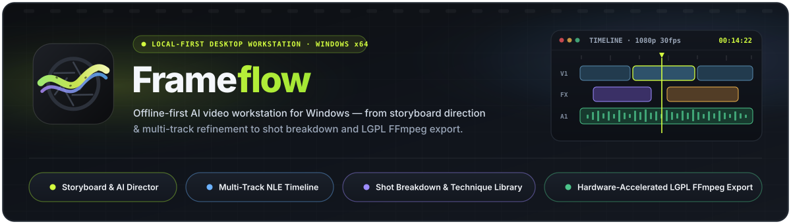
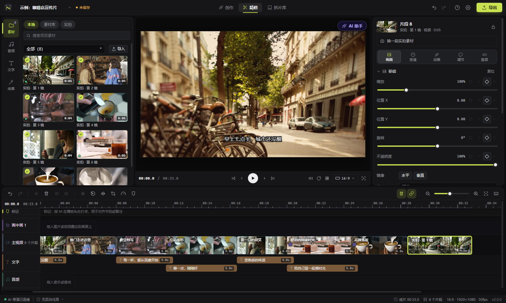
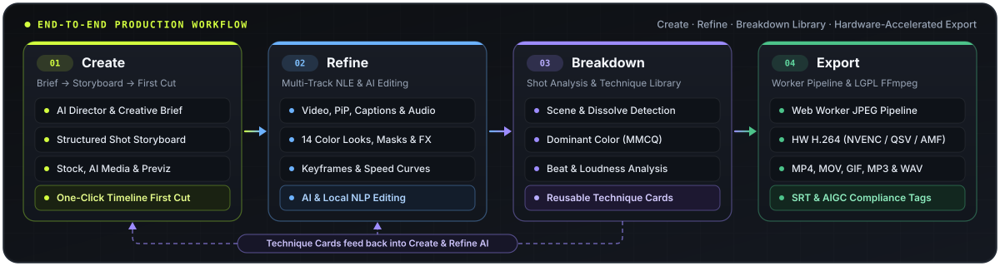
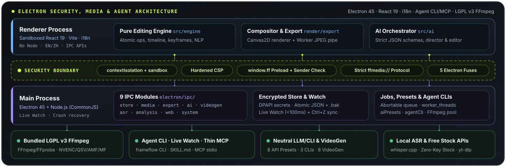

<div align="center">

<picture>
  <source media="(prefers-color-scheme: dark)" srcset="docs/images/hero-dark.svg" />
  <source media="(prefers-color-scheme: light)" srcset="docs/images/hero-light.svg" />
  
</picture>

<br />

<p>
  <a href="https://github.com/KennyMcSimpson/Frameflow/actions/workflows/ci.yml"></a>
  
  
  
  
  <a href="./LICENSE"></a>
</p>

<p>
  <strong>面向 Windows 的本地优先、AI 原生桌面视频创作工作站（镜流 Frameflow）。</strong><br />
  分镜创作 · 多轨非线性精修 · 智能拆片拉片 · 硬件加速 LGPL FFmpeg 导出 — 无账号体系、零遥测上报、完整离线剪辑与成片。
</p>

<p>
  <a href="./README.md">English</a> · <strong>简体中文</strong> &nbsp;|&nbsp;
  <a href="#为什么选择-frameflow">为什么选择</a> ·
  <a href="#三大一体化工作区">三大工作区</a> ·
  <a href="#ai-与免密钥素材生态">AI 与素材生态</a> ·
  <a href="#架构与安全设计">架构与安全</a> ·
  <a href="#快速开始">快速开始</a> ·
  <a href="./CHANGELOG.md">更新日志</a>
</p>

</div>

<p align="center">
  
  <br />
  <sub><strong>精修工作区（Refine）</strong> — 内置「清晨咖啡（Morning Coffee）」示例工程，含素材箱、统一 Canvas2D 实时预览、多轨时间线与片段参数检查器。</sub>
</p>

---

## 为什么选择 Frameflow

相比云端 AI 视频工具和传统重型剪辑软件，**镜流 Frameflow** 专注把「本地隐私、AI 导演到多轨精修的闭环、以及可审计的桌面安全边界」合二为一：

| 对比维度 | 云端 AI 视频工具 | 传统重型剪辑软件（NLE） | **镜流 Frameflow** |
| :--- | :--- | :--- | :--- |
| **隐私与资产主权** | 素材与草稿上传厂商云端，强绑定账号与按月点数消耗。 | 文件保存在本地，但常附带账号登录、后台更新器或遥测。 | **100% 本地优先** — 工程、素材、缓存与日志均留在本机磁盘；无账号、零遥测，BYOK 密钥经 Windows DPAPI 加密，不填密钥即可离线剪辑与导出。 |
| **从创意到时间线** | 生成单条片段很快，但多轨精修薄弱、自动剪辑不可控。 | 精修能力强，但 AI 分镜、动态预演与参考拉片分散在多个工具中。 | **端到端原子管线** — 创意简报 → 逐镜分镜 → 动态预演 / 8 家 AI 视频引擎 / 免密钥素材 → 一键粗剪成片 → 多轨精修，全部修改经 `applyOps` 原子落盘并支持撤销重做。 |
| **预览与导出一致性** | 云端重渲染易与网页预览偏色/错帧，且常限制分辨率与码率。 | 画面精准，但安装包动辄数 GB，学习与硬件门槛高。 | **单一 Canvas2D 合成器**同时驱动实时播放与精准逐帧导出，通过 Web Worker JPEG 管道喂给 **SHA-256 校验的 LGPL v3 FFmpeg**，支持 GPU 探测（`nvenc`/`qsv`/`amf`/`mf`）与 CPU 自动回退。 |
| **拉片学习与安全边界** | 黑盒云端服务，缺少本地拆片知识库与可验证的本地隔离边界。 | 拉片笔记靠手工整理；原生插件权限面宽。 | **内置拆片库**（自适应切镜/叠化检测、MMCQ 配色提取、70 张离线技法卡），运行于 **Electron 45 加固沙箱**（严格 CSP、异步 DNS SSRF 防护、5 项 Electron Fuses）。 |

---

## 三大一体化工作区

<p align="center">
  <picture>
    <source media="(prefers-color-scheme: dark)" srcset="docs/images/workflow-dark.svg" />
    <source media="(prefers-color-scheme: light)" srcset="docs/images/workflow-light.svg" />
    
  </picture>
</p>

| 工作区 | 核心能力 |
| :--- | :--- |
| **创作（Create）** | 与 AI 导演（或离线模板导演）对话生成结构化创意简报与逐镜分镜表；为每个镜头填入免密钥开源素材、AI 出图、AI 生成视频或带预演水印的 Canvas2D 动态预演，一键拼装为多轨粗剪时间线。 |
| **精修（Refine）** | 支持磁吸主视频轨、最多 4 条画中画/图片/贴纸叠层轨、多行字幕与标题轨、以及带波形与节拍标记的多片段音轨；内置 14 种调色风格、10 种运镜、16 种转场、8 种特效、蒙版、关键帧、变速曲线，以及区间聚焦 AI / 本地中文自然语言改片。 |
| **拆片库（Breakdown Library）** | 通过单遍扫描自适应切镜与叠化检测、MMCQ 主色调提取、运动/响度/节拍曲线与可选 AI 视觉标注，将本地视频或下载的参考视频拆解为分镜；沉淀可复用**技法卡**（内置 70 张离线技法卡），一键套用到时间线片段。 |

---

## AI 与免密钥素材生态

Frameflow 将外部服务配置与核心剪辑引擎彻底解耦——你可以自由混搭本机工具、免密钥开放版权资源与自有 API Key，也可以全程离线创作。

| 能力模块 | 支持的服务与引擎 | 说明 |
| :--- | :--- | :--- |
| **导演、脚本与智能改片** | OpenAI 兼容 Chat API、可选本机 Codex CLI、离线本地导演与中文规则引擎（`localnlp`） | 严格 JSON Schema 输出并携带全工程上下文记忆；未配置时自动降级为离线规则引擎 |
| **AI 出图** | 火山方舟（即梦 Seedream）、OpenAI 兼容出图接口 | 未配置时自动回退为明确标注预演水印的 Canvas2D 动态预演 |
| **AI 视频生成** | Seedance（火山方舟）、Runway Gen-4、Luma Ray 2、可灵 Kling、MiniMax 海螺、Google Veo、OpenAI Sora 2、Fal.ai | 内置本机 `mock` 演示适配器与按服务商维度的并发限流 |
| **语音转字幕（ASR）** | 按需下载本机 `whisper.cpp`（ggml 模型）或云端 OpenAI Whisper API | 本机模式在首次下载模型后全程离线运行、音频不离机；支持导出 `.srt` |
| **免密钥与可选素材库** | Wikimedia Commons、Openverse、Internet Archive、NASA（免 API Key）；可选 Pexels、Pixabay 及经确认启用的 `yt-dlp` | 附带 Mixkit「清晨咖啡」示例素材与 23 首 CC0 背景音乐/音效（FreePD + 合成音效） |
| **导出与合规交付** | 内置 SHA-256 校验的 LGPL v3 FFmpeg/FFprobe（`MP4`、`MOV`、`GIF`、`MP3`、`WAV`、`SRT`） | Web Worker JPEG 编码管道、GPU 探测与 CPU 回退、BT.601→BT.709 色彩标记、素材署名清单与 GB 45438-2025 AIGC 标识 |

---

## 架构与安全设计

<p align="center">
  <picture>
    <source media="(prefers-color-scheme: dark)" srcset="docs/images/architecture-dark.svg" />
    <source media="(prefers-color-scheme: light)" srcset="docs/images/architecture-light.svg" />
    
  </picture>
</p>

- **纯净可测的核心引擎（`src/engine/`）** — 零 DOM 与 Electron 依赖；时间线排布、原子编辑协议（`applyOps`）、色彩匹配、节奏对齐、变速曲线与本地自然语言解析直接在 `node --test` 下运行。工程保存采用临时文件 + `fsync` + 原子重命名及 `.prev.json` 断电恢复。
- **预览与导出共享同一合成器（`src/render/`、`src/export/`）** — 单一 Canvas2D 渲染管线同时服务实时预览与精确寻帧导出，通过内联 Web Worker（`jpegEncoder.worker.js`）异步压缩 JPEG，并以有界 32 帧背压队列写入 FFmpeg `image2pipe`。
- **Electron 45 加固沙箱与严格 CSP（`electron/main.cjs`、`src/index.html`）** — 强制开启 `contextIsolation: true`、`sandbox: true`（`app.enableSandbox()`）与主帧来源校验（`isTrustedSender`）；生产 CSP 设置 `connect-src 'self' ffmedia:` 阻断渲染进程直连外部 API 的 XHR/fetch/WebSocket 请求，同时 `img-src` / `media-src` 放行 `https:` 以渲染素材缩略图与预览。
- **本地路径与出站网络双重防线（`electron/ipc/system.cjs`、`electron/lib/urlSafety.cjs`）** — `ffmedia://` 仅向白名单内的工程/媒体路径提供 Range 流式读取（越界返回 `403`）；`shell:openPath` 强制校验 18 个扩展名白名单（`ALLOWED_OPEN_EXT`）并执行 fail-closed `realpath` 解析、UNC 路径拦截及尾部点/空格防护；异步 DNS SSRF 防护拦截环回、内网、链路本地、CGNAT 及 IPv6 映射地址，同时通过 `isTrustedHostForBase` 防止鉴权头跨站泄露。
- **凭据加密与 5 项 Electron Fuses** — 用户 API Key 经 Electron `safeStorage`（Windows DPAPI）加密存于 `%APPDATA%\Frameflow\secrets.json`，永不以明文返回渲染进程，日志写入前由 `log.redact()` 自动脱敏。打包阶段自动校验全部 5 项 Electron Fuses（`RunAsNode`、`NodeOptions`、`NodeCliInspect`、`EmbeddedAsarIntegrityValidation`、`OnlyLoadAppFromAsar`）。
- **深入阅读** — 详细模块边界与 IPC 协议见 [docs/ARCHITECTURE.md](docs/ARCHITECTURE.md)，本地存储与联网披露见 [docs/PRIVACY.md](docs/PRIVACY.md)（[English](docs/PRIVACY.en.md)），安全漏洞上报流程见 [SECURITY.md](SECURITY.md)。

---

## 快速开始

> **界面语言说明：** 当前桌面客户端内置界面为简体中文（`zh-CN`），开发者文档、架构指南与社区规范提供英文及中文版本。

**环境要求：** Windows 10/11（x64）与 [Node.js 22+](https://nodejs.org/)。

```powershell
git clone https://github.com/KennyMcSimpson/Frameflow.git
cd Frameflow
npm ci

# 可选：拉取「清晨咖啡」示例视频与内置 CC0 音频素材库
npm run fetch:sample-media
npm run fetch:builtin-audio

# 启动 Vite 开发服务器与 Electron 客户端
npm run dev
```

开发模式下，Frameflow 会优先从 `vendor/ffmpeg/bin` 解析 FFmpeg（若已运行 `npm run fetch:ffmpeg`），否则自动回退到 npm 安装的 `ffmpeg-static` / `ffprobe-static`。正式打包构建严格仅随包分发经 SHA-256 校验的 LGPL v3 动态链接版 FFmpeg，并彻底排除 GPL 静态包。

---

## 测试与打包

```powershell
# 单元测试与模块测试（56 套测试文件：694 个离线测试通过 + 1 个显式开关控制的联网测试）
npm test

# 构建生产版渲染进程资源（Vite -> dist-renderer/）
npm run build:renderer

# Playwright + Electron 端到端冒烟测试
npm run e2e

# 全链路端到端测试（导入素材 -> 多轨编辑 -> 导出 MP4 -> FFprobe 校验）
npm run e2e:full

# 构建 Windows NSIS 安装包与绿色便携版（含 LGPL FFmpeg 拉取、许可清单生成、Fuses 与 ASAR 审计）
npm run dist
npm run dist:portable
```

打包流程会自动执行 `scripts/after-pack.cjs` 与 `scripts/check-artifacts.mjs`，逐项核验 5 项 Electron Fuses、LGPL v3 FFmpeg 合规性、第三方许可文件、`app.asar` 中无 sourcemap 或 GPL 静态二进制文件以及体积预算。

---

## 项目结构

```text
Frameflow/
├── electron/
│   ├── main.cjs                # 加固 Electron 主进程、ffmedia:// 协议、崩溃恢复
│   ├── preload.cjs             # 沙箱 contextBridge，暴露最小化 window.ff 接口
│   ├── ipc/                    # 9 个业务域 IPC 模块（store、media、export、ai、videogen、asr、analysis、web、system）
│   └── lib/                    # FFmpeg/编码器探测、拆片 worker、urlSafety SSRF 防护、safeStorage、视频生成适配器
├── src/
│   ├── engine/                 # 纯 JS 剪辑引擎（model、timeline、ops、history、keyframes、localnlp、70 张技法卡）
│   ├── render/                 # Canvas2D 合成器、14 种风格、转场、运镜、文字、动态预演、mediaPool
│   ├── ai/                     # 严格 JSON Schema、导演/精修/拆片提示词、离线 localDirector
│   ├── export/                 # 导出驱动、Web Worker JPEG 编码器、audioPlan、预设、AIGC 标识元数据
│   ├── ui/                     # React 19 界面（创作/精修/拆片库工作区、弹窗、Zustand 状态库）
│   └── styles/                 # 暗色工作室设计令牌与样式表
├── scripts/                    # 开发启动器、LGPL FFmpeg 拉取脚本、示例/音频拉取脚本、许可与产物审计
├── tests/                      # 56 套 Node 单元与集成测试（*.test.mjs）
├── e2e/                        # Playwright Electron 冒烟、全流程、打包产物与渲染测试套件
├── build/                      # 应用图标、MIT 安装许可、隐私说明、生成的 THIRD_PARTY_LICENSES.txt
└── docs/                       # 架构文档、中英双语隐私说明、深浅自适应 SVG 架构图与示例素材许可
```

---

## 开源协议与第三方声明

- **源代码协议：** 采用 [MIT License](LICENSE) 开源。
- **随包 FFmpeg：** 未经修改地分发动态链接版 **LGPL v3** 构建（`resources/ffmpeg/`），用户可按 LGPL 条款自行替换；固定源码来源与许可详情见 [build/THIRD_PARTY_LICENSES.txt](build/THIRD_PARTY_LICENSES.txt)。
- **示例素材与内置音频：** Mixkit 免费许可示例视频（[docs/licenses/sample-media.md](docs/licenses/sample-media.md)）及 23 首 CC0 1.0 FreePD 背景音乐 / 合成音效。
- **隐私与社区文档：** [隐私说明 (中文)](docs/PRIVACY.md) · [Privacy Notice (English)](docs/PRIVACY.en.md) · [安全策略](SECURITY.md) · [贡献指南](CONTRIBUTING.md) · [更新日志](CHANGELOG.md)
