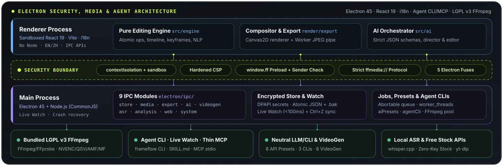

# Frameflow Architecture

This document describes the **v2.1.0** architecture of Frameflow across its Electron main process, sandboxed bilingual React renderer, pure editing engine, Outside-In Agent integration layer (Headless CLI, Live Watch, Cross-Host Skill, and Opt-In Thin MCP), neutral AI/CLI adapters, media/export pipeline, security boundary, and automated Windows release pipeline.

<p align="center">
  <picture>
    <source media="(prefers-color-scheme: dark)" srcset="images/architecture-dark.svg" />
    <source media="(prefers-color-scheme: light)" srcset="images/architecture-light.svg" />
    
  </picture>
</p>

---

## 1. High-Level Process Model

Frameflow follows a strict two-process Electron 45 architecture written in plain JavaScript (ESM in `src/` and `bin/`, CommonJS in `electron/`), paired with an Outside-In CLI/MCP integration surface that operates directly on the same pure editing engine:

| Process / Surface | Entry Point | Runtime & Key Responsibilities |
| --- | --- | --- |
| **Renderer** | `src/index.html` → `src/main.jsx` | Sandboxed Chromium (`React 19`, `Vite 7`, `Zustand 5`). Owns bilingual UI state (`src/ui/i18n.js`), pure editing logic (`src/engine/`), Canvas2D compositing (`src/render/`), Web Worker JPEG encoding (`src/export/`), and AI prompt/schema construction (`src/ai/`). Has **no** Node.js access; CSP `connect-src 'self' ffmedia:` blocks direct renderer XHR/fetch/WebSocket calls to external APIs, while `img-src` and `media-src` permit `https:` for stock-media thumbnail and preview rendering. |
| **Preload** | `electron/preload.cjs` | Sandboxed bridge exposing a minimal `window.ff` API via `contextBridge`: `invoke`, `on`, `flushed`, `pathForFile`, `mediaUrl`, and typed convenience wrappers for `videogen`, `asr`, and `exportFrame`. Buffers early sticky events (`app:openFile`, `app:crashRecovered`) until UI listeners attach. |
| **Main** | `electron/main.cjs` | Privileged Node.js coordinator. Enforces single-instance locking, `.ffproj` file association routing, security policies, `ffmedia://` streaming, encrypted secret storage, Desktop Live Watch (`projectWatch.cjs`), neutral AI presets & opt-in local Agent CLI adapters (`aiPresets.cjs`, `agentCli.cjs`), background job lifecycle, subprocess cleanup, and crash recovery. |
| **Agent CLI & Thin MCP** | `bin/frameflow.mjs`, `bin/frameflow-mcp.mjs` | Zero-daemon headless Node.js ESM interfaces executing directly against `src/engine/` and `src/ai/` on local `.ffproj` files. Atomic writes (`tmp + fsync + rename`, `.bak.ffproj` backup, `meta.lastAgentEdit`) trigger Main's Live Watch to hot-reload the open desktop GUI in `<100ms` with full `Ctrl+Z` undo support. |

---

## 2. Renderer Subsystems (`src/`)

### 2.1 Pure Editing Engine (`src/engine/`)
All editing state transitions live in pure, side-effect-free modules with zero DOM or Electron dependencies so they execute identically inside the desktop Renderer, `bin/frameflow.mjs`, and `node --test`:

- **`model.js` & `migrations.js`** — Canonical project schema (`PROJECT_VERSION = 3`), defaults, clamping limits (up to 200 clips, 600 s max duration, 4 overlay tracks, speed range `0.1×–10×`), aspect presets (`16:9`, `9:16`, `1:1`, `4:3`, `21:9`), 14 looks, 10 motions, 16 transitions, 8 FX, 7 text presets, 4 mask shapes, 7 blend modes, and 6 speed-curve presets.
- **`timeline.js`** — Magnetic main-track layout (`layoutVideo`) with transition overlaps, active clip lookup (`activeAt`), overlay/text scheduling, and duration math.
- **`ops.js` & `history.js`** — Unified atomic editing protocol (`applyOps(project, ops, ctx)`) shared by the Inspector UI, AI Editor, local NLP parser, Technique Cards, and headless `frameflow apply` CLI. If any operation in a batch fails validation (e.g., locked clip or track, out-of-range index), the entire batch aborts without mutating state. `history.js` manages bounded undo/redo snapshots (including Live Watch external-edit snapshots).
- **`localnlp.js`** — Offline rule-based Chinese editing parser supporting compound commands, ordinal/range clip targeting, color/look/motion/transition/FX/speed/audio edits, color harmonization, and pacing. Any unrecognized clause halts execution (`unknown` non-empty) so callers can prompt or escalate to an LLM.
- **`firstcut.js`, `colormatch.js`, `consistency.js`, `pacing.js`, `keyframes.js`, `captions.js`, `license.js`** — One-click rough cut assembly from storyboards, cross-clip color statistics matching, whole-project color baseline harmonization, beat/pacing retiming, keyframe interpolation, SRT caption formatting, and automatic media license credit generation.
- **`techniques.js` & `builtinTechniques.js`** — Searchable library containing **70 built-in offline Technique Cards** across 11 filmmaking categories (`transition`, `lighting`, `camera`, `rhythm`, `composition`, `color`, `dialogue`, `vfx`, `product`, `narrative`, `sound`), many carrying directly applicable `ops` templates.

### 2.2 Unified Canvas2D Compositor (`src/render/`)
Preview playback and final export share one rendering pipeline (`compositor.js`) to minimize WYSIWYG drift:

- **`compositor.js`** — Reuses pooled offscreen/DOM surfaces (`SurfaceSet`) per output resolution. Renders main-track clips (including dual-clip transitions), PiP/image/sticker overlays with blend modes and masks, primary grading + tone overlays (`looks.js`), procedural FX (`blur`, `grain`, `glow`, `sharpen`, `letterbox`, `chromatic`, `vhs`, `flash`), camera motion + keyframed transforms (`motion.js`), animated Canvas2D Previz (`previz.js`), and captions/titles (`text.js`).
- **`mediaPool.js`** — Manages reusable `<video>` elements and `ImageBitmap` caches with exact-frame seeking (`seeked` + `requestVideoFrameCallback`) during export.

### 2.3 Export Driver & Web Worker JPEG Pipeline (`src/export/`)
- **`exporter.js`** — Drives frame-by-frame rendering with a depth-1 pipeline (while frame `i` encodes/streams to main, frame `i+1` seeks and composites). Handles cancellation, GPU-to-CPU mid-export fallback retry, optional sidecar `.srt` generation, automatic license credits, and GB 45438-2025 AIGC visible badges + implicit container metadata (`aigc.js`).
- **`jpegEncoder.js` & `jpegEncoder.worker.js`** — Transfers rendered frames as `ImageBitmap` to an inline Vite Web Worker (`?worker&inline`, compatible with packaged `file://` origins) to encode high-quality intermediate JPEGs (`quality >= 0.95`) off the UI thread.
- **`audioPlan.js` & `presets.js`** — Computes normalized multi-track audio segment plans (volume keyframes, fades, reverse, denoise, speed ramps) and resolves platform/format presets (`MP4`, `MOV`, `GIF`, `MP3`, `WAV`).

### 2.4 AI Orchestration (`src/ai/`)
- **`schemas.js`** — Strict JSON Schemas (`additionalProperties: false`) for Director replies, Storyboards, Editing Op batches, Breakdown analysis, and asset tagging.
- **`director.js`, `editor.js`, `analyze.js`, `memory.js`, `budget.js`, `diff.js`, `lint.js`** — Build compact context prompts (including project summaries, style guides, color baselines, and range-focused neighboring shots), validate/lint AI responses, and compute human-readable operation diffs.
- **`localDirector.js` & `client.js`** — Wraps `ai:run` background jobs and cleanly falls back to offline template storyboarding when `NO_AI` is returned.

### 2.5 Bilingual Internationalization (`src/ui/i18n.js`)
- **`src/ui/i18n.js`** — Zero-dependency localization layer supporting full **`English` (`en-US`)** and **`简体中文` (`zh-CN`)** UI strings with parameter interpolation and deterministic fallback lookup.
- Language preference persists in `settings.json` and updates live across Workspaces, TopBar, dialogs, inspectors, and toasts without reloading the BrowserWindow.

---

## 3. Main Process Subsystems (`electron/`)

### 3.1 Domain IPC Modules (`electron/ipc/`)
`electron/main.cjs` loads 9 domain modules via `createHandle()` (which enforces unique channel registration, sender validation, structured `{ ok, data | error, code }` responses, and in-flight tracking for graceful shutdown):

| Module | Responsibilities |
| --- | --- |
| `store.cjs` | Settings, encrypted secret flags, atomic project CRUD (`project.json` + `project.prev.json` + version snapshots), `.ffproj`/JSON import & export, and self-write coordination with `projectWatch.cjs` so internal saves never trigger redundant Live Watch reloads. |
| `media.cjs` | `ffprobe` inspection, cached thumbnails/filmstrips/waveforms, color stats, asset import, and automatic H.264 proxy transcoding for browser-incompatible codecs. |
| `export.cjs` | FFmpeg `image2pipe` H.264/MOV/GIF/MP3/WAV pipeline, bounded 32-frame backpressure queue, audio `filter_complex` mixing (`atempo` chains, speed curves, `afftdn`, volume keyframes), BT.601→BT.709 color conversion, and AIGC metadata embedding. |
| `ai.cjs` | Neutral multi-provider LLM & image transport powered by `aiPresets.cjs` (OpenAI, DeepSeek, native Anthropic Messages API, Google Gemini, OpenRouter, Volcengine Ark, keyless local Ollama / LM Studio), opt-in equal-footing local Agent CLIs via `agentCli.cjs` (`claude`, `codex`, `gemini`), Ark/OpenAI image generation, and `NO_AI` offline fallback. |
| `videogen.cjs` | Unified task lifecycle (submit → backoff poll → download → transcode/import) across 9 adapters in `electron/lib/videogen/`: `seedance`, `kling`, `minimax`, `runway`, `veo`, `sora`, `luma`, `fal`, and `mock`. |
| `asr.cjs` | Audio extraction + transcription via on-demand local `whisper.cpp` (ggml models) or cloud OpenAI Whisper API. |
| `analysis.cjs` | Shot breakdown job orchestration, contact sheet generation, and local library persistence (`analyses/`, `techniques.json`, `assets.json`). |
| `web.cjs` | Parallel multi-source search and download: zero-key Wikimedia Commons, Openverse, Internet Archive, NASA; opt-in Pexels/Pixabay; consent-gated `yt-dlp` reference search/download (YouTube, Bilibili). |
| `system.cjs` | `app:info`, native file/folder dialogs, safe external URL/file opening, `media:register`, Windows taskbar progress, and notifications. |

### 3.2 Core Main-Process Libraries (`electron/lib/`)
- **`projectWatch.cjs` (Desktop Live Watch)** — Pure Node.js watcher (zero Electron dependencies) monitoring the active project file's parent directory filtered by exact basename so Windows atomic temp-file renames are caught reliably. Enforces fail-closed UNC/symlink guards (`assertSafeLocalFile`), tracks bounded SHA-256 content digests (10 s TTL) to suppress self-write echoes, retries transient `EBUSY`/`ENOENT`/`EPERM`/`EACCES` locks, validates JSON integrity (`<= 200 MiB`), and delivers external edits to the Renderer in **`<100ms`** where the store pushes a standard undo snapshot so `Ctrl+Z` cleanly reverts external edits.
- **`aiPresets.cjs` (Neutral Multi-API Presets)** — Pure Node.js registry of 8 frozen default provider presets: **OpenAI**, **DeepSeek**, **Anthropic Claude** (native `/v1/messages` `2023-06-01` request/response translation), **Google Gemini**, **OpenRouter**, **Volcengine Ark**, and keyless local **Ollama** (`127.0.0.1:11434`) / **LM Studio** (`127.0.0.1:1234`). Includes `isLocalKeylessUrl()` strictly restricted to `localhost`, `127.0.0.1`, or `::1` so SSRF guards remain fail-closed for all cloud URLs.
- **`agentCli.cjs` (Equal-Footing Opt-In Local Agent CLIs)** — Pure Node.js adapter supporting **Claude Code (`claude`)**, **Codex CLI (`codex`)**, and **Gemini CLI (`gemini`)** on equal footing. Enforces strict path validation (`isValidCliPath` rejecting UNC paths, realpath UNC escapes, and invalid binary names), model identifier validation (`validateCliModel`, anti-flag-injection), safe Windows `.cmd` shim resolution (`resolveCmdShim` / `quoteForCmd`), bounded stdout/stderr caps (`2 MiB` / `256 KiB`), and process-tree termination on abort. Strictly opt-in per user selection — never silently overrides configured API keys or neutral presets.
- **`paths.cjs`** — Deterministic binary resolution for FFmpeg/FFprobe:
  1. `FF_FFMPEG` / `FF_FFPROBE` environment overrides (development only)
  2. `<resources>/ffmpeg/` (packaged LGPL v3 shared build)
  3. `<repo>/vendor/ffmpeg/bin/` (development LGPL build from `scripts/fetch-ffmpeg.mjs`)
  4. `ffmpeg-static` / `ffprobe-static` (development fallback only; strictly excluded from packaged ASAR)
- **`encoders.cjs`** — Real 1-frame hardware encoder probing (cached weekly in `<userData>/encoders.json`) prioritized as:
  `h264_nvenc` > `h264_qsv` > `h264_amf` > `h264_mf` (HW) > `libx264` > `libopenh264` / `h264_mf` (SW). Tracks runtime failures and temporarily demotes flaky GPU encoders after repeated failures.
- **`shotdetect.cjs` & `analyzer.cjs`** — Single-pass FFmpeg `128×72` `rgb24` stream processed inside Node `worker_threads` (loaded via eval-compatible source so it works inside `app.asar`). Implements PySceneDetect-inspired adaptive/content/threshold cut detection, linear-blend dissolve detection, flash filtering, keyframe sharpness/exposure scoring, MMCQ dominant color extraction (`quantize.js` / Color Thief), and audio loudness/beat peak detection.
- **`urlSafety.cjs`** — Outbound URL and UNC path hardening: blocks loopback, RFC 1918 private, link-local, CGNAT, and mapped/reserved IPv6 hosts (`assertSafePublicUrl`), performs async DNS resolution verification (`assertSafePublicUrlAsync`) to defeat DNS rebinding/private-domain SSRF, and enforces strict trusted-host credential scoping (`isTrustedHostForBase`).
- **`settings.cjs`** — Atomic temp-file + `fsync` + rename persistence with `.bak` recovery and `.corrupt-<timestamp>` quarantine on parse failure. API keys are encrypted via Electron `safeStorage` into `<userData>/secrets.json`.
- **`jobs.cjs`, `proc.cjs`, `log.cjs`** — Abortable job registry streaming `job:progress` / `job:done` / `job:error`, tracked subprocess spawning with tree termination on quit (`proc.killAll()`), and redacted rotating logs (`log.redact()`).

---

## 4. Outside-In Agent Integration Layer (`bin/`, `skills/`)

Frameflow follows a **Thin Shell + Pure Engine Core** integration model so external coding agents can work with `.ffproj` projects with minimal overhead:

1. **Headless Agent CLI (`bin/frameflow.mjs`)** — Zero-dependency Node.js ESM CLI (`npm run cli` / `frameflow` bin) exposing 10 deterministic `--json` subcommands directly over `src/engine/` and `src/ai/`:
   - `init` — create a canonical v3 `.ffproj` file atomically
   - `inspect` — return structured project metadata, storyboard, tracks, clips, overlays, markers, and optional `--focus <start>..<end>` slice (e.g. `0..15`; `0:15` is also accepted)
   - `ops-schema` — dump all 55 supported `OP_TYPES`, enums, ranges, targeting rules, and example payloads
   - `storyboard` — generate creative brief + shot-by-shot storyboard and optional `--first-cut` previz timeline; auto-creates `<file.ffproj>` if absent and writes `<file>.bak.ffproj` before overwriting an existing file (matching MCP `frameflow_storyboard`)
   - `apply` — accept ops via `--ops <ops.json> | --ops-json '<json>' | --stdin` (`--ops -` works as a stdin alias) and execute `lintOps` → `applyOps` → `diffProject` → `needsConfirm` (`--dry-run`, `--allow-destructive`, `--agent`, `--label`), writing atomically with `.bak.ffproj` backup and `meta.lastAgentEdit` metadata
   - `breakdown` — run local FFmpeg/FFprobe shot detection, rhythm/palette analysis, and Technique Card inference
   - `stock search` — query zero-key open-license archives (Wikimedia Commons, Openverse, Internet Archive, NASA)
   - `export-srt` — export `.srt` captions (respecting `trackState.text.hidden`)
   - `export-plan` — compute video/audio render segments and encoder readiness without rendering
   - `doctor` — verify Node.js runtime, engine modules, and FFmpeg/FFprobe readiness
2. **Cross-Host Agent Skill (`skills/frameflow/SKILL.md`)** — Zero-hardcoded-path skill contract dynamically resolving `<repoRoot>` for Antigravity, Claude Code, Codex CLI, Gemini CLI, OpenCode, and PI. Keeps agent workflows zero-daemon and avoids standing MCP schema token overhead.
3. **Opt-In Thin MCP Server (`bin/frameflow-mcp.mjs`)** — Zero-dependency stdio JSON-RPC 2.0 MCP server (`npm run mcp` / `frameflow-mcp` bin) supporting both LSP `Content-Length` and `ndjson` framing plus `--readonly` mode, exposing 6 minimal typed tools (`frameflow_inspect`, `frameflow_ops_schema`, `frameflow_apply_ops`, `frameflow_storyboard`, `frameflow_stock_search`, `frameflow_export_srt`) over the exact same engine pipeline.
4. **Live Synchronization Loop** — Any atomic `.ffproj` / `project.json` update written by `bin/frameflow.mjs` or `bin/frameflow-mcp.mjs` is detected by `electron/lib/projectWatch.cjs`, reloaded into the desktop app in `<100ms`, and recorded in `history.js` for instant `Ctrl+Z` rollback.

See [AGENT-INTEGRATION.md](AGENT-INTEGRATION.md) for usage examples, schemas, destructive-edit gate rules, and host setup details.

---

## 5. Security & Reliability Controls

Frameflow implements defense-in-depth aligned with the Electron security checklist:

1. **BrowserWindow Isolation** — `contextIsolation: true`, `sandbox: true` (+ `app.enableSandbox()`), `nodeIntegration: false`, `nodeIntegrationInWorker: false`, `nodeIntegrationInSubFrames: false`, `webSecurity: true`, `allowRunningInsecureContent: false`, `webviewTag: false`, `navigateOnDragDrop: false`, `safeDialogs: true`.
2. **Hardened Production CSP** — Declared in `src/index.html`: `default-src 'self'; script-src 'self'; connect-src 'self' ffmedia:; img-src 'self' data: blob: ffmedia: https:; media-src 'self' blob: ffmedia: https:; worker-src 'self' blob:; object-src 'none'; frame-src 'none'; base-uri 'none'; form-action 'none'` (`connect-src` blocks direct renderer XHR/fetch/WebSocket calls to external APIs, while `img-src` and `media-src` permit `https:` for stock-media thumbnails and previews). Vite dev mode (`vite.config.mjs`) appends localhost HMR origins only during development.
3. **IPC Sender Verification** — `isTrustedSender()` checks `event.senderFrame` has no parent frame and matches either the packaged `dist-renderer/` `file://` root or (in development only) a validated loopback `FF_DEV_URL`.
4. **Scoped `ffmedia://` Media Protocol** — Serves local files with HTTP `Range` support (`206 Partial Content`) only if the canonicalized path is in `allowedMedia` or beneath `dataRoot`, `tmp`, or bundled `mediaRoots`; returns `403` otherwise.
5. **Navigation, Permission & Shell Restrictions** — Blocks `<webview>`, redirects, and popup windows; only `https:` URLs pass to `shell.openExternal`; default-deny permission handlers allow only `clipboard-sanitized-write` and `fullscreen` from the main frame; USB/HID/serial device permissions are denied; `shell:openPath` enforces an 18-extension allowlist (`ALLOWED_OPEN_EXT`) with fail-closed `realpath` resolution, UNC path rejection, and trailing dot/space protection; local Agent CLI adapters enforce strict binary-path UNC/realpath checks, anti-flag-injection model validation, and safe `.cmd` shim resolution while core engine/MCP modules never invoke a shell.
6. **Outbound SSRF & Credential Scoping** — Outbound main-process fetches across cloud AI, video generation, stock download, ASR, and `yt-dlp` validate targets via `assertSafePublicUrlAsync` (blocking private/loopback/link-local/CGNAT/mapped IPv6 DNS records) and restrict authorization headers via `isTrustedHostForBase`. Local keyless LLM endpoints (`ollama`, `lmstudio`) are permitted strictly on `localhost` / `127.0.0.1` / `::1` via `isLocalKeylessUrl()`.
7. **Hardened Electron Fuses** — Configured in `package.json` and audited post-build by `scripts/check-artifacts.mjs`:
   - `runAsNode: false`
   - `enableNodeOptionsEnvironmentVariable: false`
   - `enableNodeCliInspectArguments: false`
   - `enableEmbeddedAsarIntegrityValidation: true`
   - `onlyLoadAppFromAsar: true`
8. **Crash & Shutdown Resilience** — `running.lock` heartbeat detects unclean exits; `win.on('close')` warns about active jobs and awaits renderer flush (`app:flush` → `app:flushed`) before exit; repeated renderer or GPU crashes within 5 minutes offer a one-click software-rendering fallback (`hardwareAcceleration: false`).

---

## 6. Local Data Layout

| Location | Contents |
| --- | --- |
| `%APPDATA%\Frameflow\settings.json` | User preferences including UI locale (`en-US`/`zh-CN`) and AI preset/CLI config (atomic write + `.bak`) |
| `%APPDATA%\Frameflow\secrets.json` | OS-encrypted API keys (`safeStorage` / Windows DPAPI) |
| `%APPDATA%\Frameflow\logs\` | Redacted runtime logs (`main.log`) |
| `%APPDATA%\Frameflow\bin\`, `models\` | On-demand `yt-dlp`, `whisper.cpp`, and ggml Whisper models |
| `%USERPROFILE%\Documents\Frameflow\` (configurable) | `projects/<id>/project.json` (watched by Live Watch), `projects/<id>/cache/`, `library/analyses/`, `library/media/`, `library/techniques.json`, `cache/thumbs/`, `cache/waveforms/` |
| `<OS Temp>\frameflow\` | Ephemeral media processing scratch files |

---

## 7. Build, Packaging & Automated Release Pipeline

### Local Packaging (`npm run dist` / `npm run dist:portable`)
```text
npm run dist / dist:portable
  1. scripts/fetch-ffmpeg.mjs    -> Downloads pinned BtbN win64-lgpl-shared FFmpeg, verifies SHA-256,
                                    validates LGPL v3 config + required encoders/filters
  2. vite build                  -> Compiles sandboxed renderer into dist-renderer/ (no sourcemaps)
  3. scripts/gen-licenses.mjs    -> Generates build/THIRD_PARTY_LICENSES.txt and syncs license artifacts
  4. electron-builder --win      -> Packages app.asar + extraResources (ffmpeg, licenses, sample-media, builtin-audio),
                                    runs scripts/after-pack.cjs, flips 5 Electron Fuses, builds NSIS / Portable
  5. scripts/check-artifacts.mjs -> Read-only audit of fuses, LGPL FFmpeg, license files, ASAR hygiene, and size budgets
```

### Automated GitHub Windows Releases (`.github/workflows/windows-release.yml`)
Triggered on pushed version tags (`v*`) or manual `workflow_dispatch`:
1. `build-windows` (`windows-latest`, least-privilege `contents: read`): installs dependencies (`npm ci`), executes the full unit/integration test suite (`npm test`), and fetches pinned LGPL v3 FFmpeg plus audio and best-effort sample-media assets.
2. Builds both the **Windows x64 NSIS Installer** (`Frameflow-<version>-x64.exe`) and **Portable Executable** (`Frameflow-Portable-<version>.exe`), enforcing `after-pack.cjs` and `check-artifacts.mjs` audits, computes cryptographic digests into **`SHA256SUMS.txt`**, and uploads the release artifact bundle.
3. `publish-release` (`ubuntu-latest`, `contents: write`, tag pushes or non-dry-run dispatches): downloads the verified artifact bundle and attaches all release binaries and checksums to the GitHub Release.
